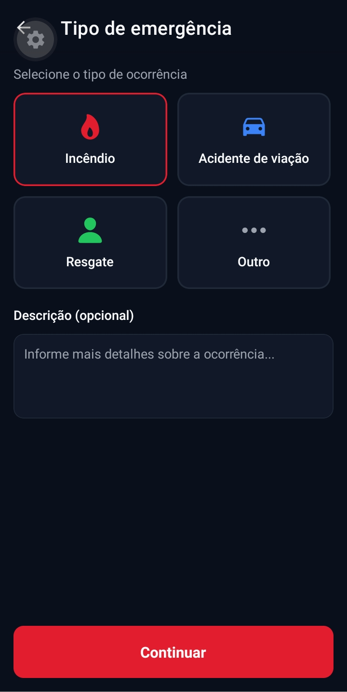
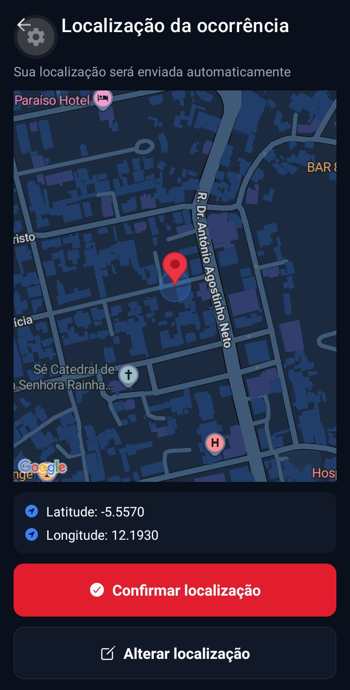

# sos-mobile

Aplicação móvel para cidadãos pedirem socorro aos **Bombeiros Angola**, com localização por GPS em tempo real e acompanhamento do atendimento. Feita com **React Native** e **Expo**.

## Screenshots

| Início | Tipo de ocorrência | Localização |
|:---:|:---:|:---:|
|  |  |  |

## Funcionalidades

- Pedido de socorro em poucos toques
- Seleção do tipo de ocorrência (incêndio, acidente de viação, resgate, outro)
- Mapa com GPS em tempo real e ajuste manual do ponto
- Ligação direta para o **115**
- Acompanhamento das etapas do atendimento
- Perfil sem autenticação, com preferências guardadas no dispositivo
- Ajuda e perguntas frequentes
- Interface escura

## 🛠️ Tecnologias

- [React Native](https://reactnative.dev/)
- [Expo](https://expo.dev/) + [Expo Router](https://docs.expo.dev/router/introduction/)
- TypeScript
- `expo-location` e `react-native-maps`
- `@react-native-async-storage/async-storage`

## Estrutura

```
src
├── app
│   ├── _layout.tsx
│   ├── emergency-type.tsx
│   ├── location.tsx
│   ├── help.tsx
│   └── (tabs)
│       ├── _layout.tsx
│       ├── index.tsx
│       ├── incidents.tsx
│       └── profile.tsx
├── assets
├── components
│   ├── Button.tsx
│   └── SettingsRow.tsx
├── hooks
│   └── useStoredBoolean.ts
└── theme.ts
```

## Como executar

```bash
# clonar o repositório
git clone <url-do-repositorio>
cd sos-mobile

# instalar dependências
npm install

# iniciar o projeto
npx expo start -c
```

Abre a app com o **Expo Go** num telemóvel físico (recomendado para testar o GPS) ou num emulador.

## Configuração

- **Localização:** a permissão está configurada no `app.json` através do plugin `expo-location`.
- **Google Maps (Android):** em builds próprios é preciso uma API key em `android.config.googleMaps.apiKey` no `app.json`.

## Licença

A definir.

## Autor

Desenvolvido por **[teu nome]**.